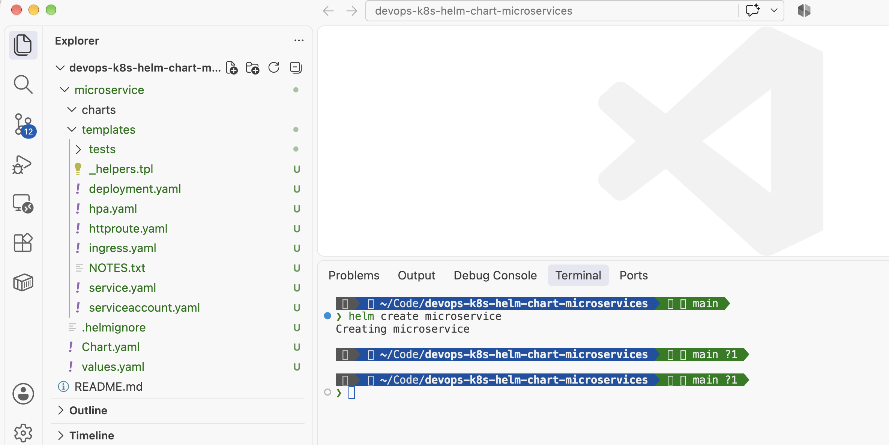
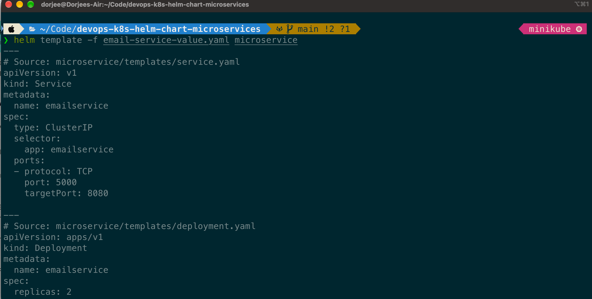
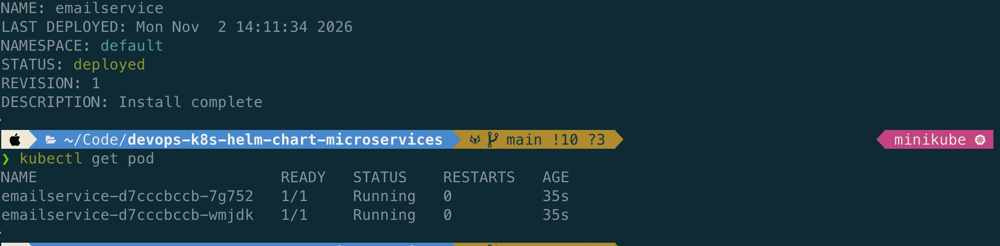
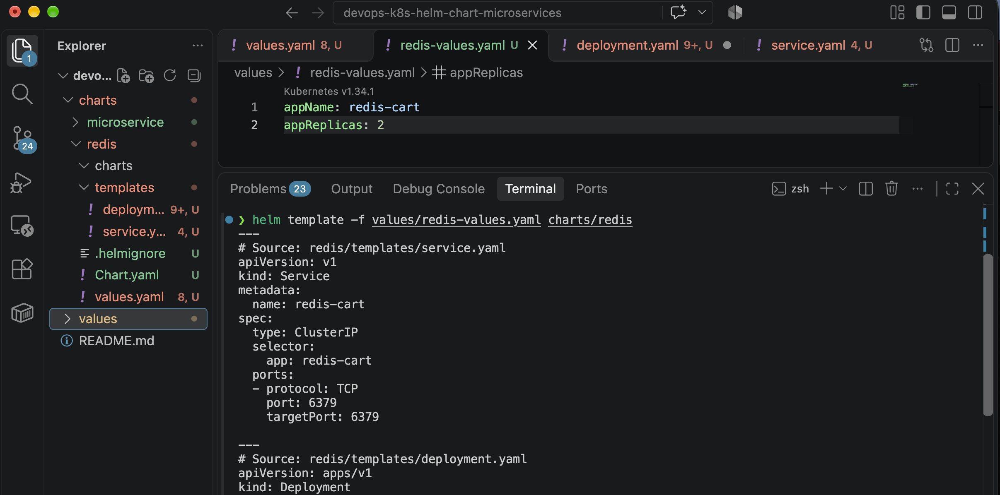

# Create a Reusable Helm Chart for Microservices


A hands-on DevOps project where I turn the plain Kubernetes manifests of an online shop (11 microservices) into **one shared, reusable Helm chart**. Instead of copy-pasting a Deployment and Service for every service, I template them once and only change a small values file per service.

---

## Table of Contents

- [Overview](#overview)
- [Approach: One Chart or Many?](#approach-one-chart-or-many)
- [Prerequisites](#prerequisites)
- [Project Structure](#project-structure)
- [Step-by-Step Guide](#step-by-step-guide)
  - [1. Create the chart](#1-create-the-chart)
  - [2. Templatize the Deployment](#2-templatize-the-deployment)
  - [3. Templatize the Service](#3-templatize-the-service)
  - [4. Dynamic environment variables](#4-dynamic-environment-variables)
  - [5. Define default values](#5-define-default-values)
  - [6. Create a custom values file per service](#6-create-a-custom-values-file-per-service)
  - [7. Validate the chart](#7-validate-the-chart)
  - [8. Deploy to the cluster](#8-deploy-to-the-cluster)
  - [9. Redis chart](#9-redis-chart)
- [Troubleshooting](#troubleshooting)
- [Key Takeaways](#key-takeaways)
- [Author](#author)

---

## Overview

In my previous project I wrote the Deployment and Service files for every microservice by hand:
[devops-k8s-microservices-online-shop](https://gitlab.com/cloudbuildops/devops-k8s-microservices-online-shop)

That works, but most of those files are almost identical. Only a few values change: name, image, version, ports and environment variables. Maintaining 11 near-copies is error-prone and doesn't scale.

**Helm** solves this. A chart is a template plus a values file, and Helm fills in the blanks when you install or render it. In this project I use the manifests from the previous project as the starting point and build reusable configuration out of them.

Project repository: [devops-k8s-helm-chart-microservices](https://gitlab.com/cloudbuildops/devops-k8s-helm-chart-microservices.git)

## Approach: One Chart or Many?

There are two common ways to structure Helm charts for microservices:

1. **One Helm chart per microservice**
2. **One shared Helm chart for all microservices**

A combination of both is also possible.

**My choice: one shared chart.** Most services in this shop have the same shape (one Deployment, one Service, some env vars), so a single `microservice` chart covers them. Services that differ (Redis, which needs a volume and health probes) get their own chart.

## Prerequisites

- **Kubernetes cluster** (I used Minikube)
- **kubectl**
- **Helm 3**
- **VS Code** (or any editor)
- Basic knowledge of Kubernetes Deployments and Services

## Project Structure

```
.
├── README.md
├── charts/
│   ├── microservice/              # shared chart for all regular services
│   │   ├── Chart.yaml             # chart metadata
│   │   ├── charts/                # chart dependencies
│   │   ├── .helmignore            # files Helm should ignore
│   │   ├── templates/             # core of the chart
│   │   │   ├── deployment.yaml
│   │   │   └── service.yaml
│   │   └── values.yaml            # default values
│   └── redis/                     # separate chart for Redis
└── values/
    ├── email-service-values.yaml  # custom values for emailservice
    └── redis-values.yaml          # custom values for redis
```

**Screenshot:** folders created by `helm create`



What each part does:

| Item | Purpose |
|---|---|
| `Chart.yaml` | Metadata about the chart (name, version, description) |
| `charts/` | Holds dependency charts |
| `.helmignore` | Files and folders to leave out when packaging |
| `templates/` | The core of the chart, templated Kubernetes manifests |
| `values.yaml` | The actual values that fill the placeholders |

## Step-by-Step Guide

### 1. Create the chart

```bash
helm create microservice
```

This generates the default chart skeleton. I removed the example files in `templates/` and added my own.

### 2. Templatize the Deployment

I took the basic Deployment from the previous project and replaced the fixed values with Helm expressions. The `{{ }}` brackets are placeholders that Helm replaces with the real value.

**Naming convention for variables:** start with a lowercase letter and use camelCase (`appName`, `containerPort`).

`templates/deployment.yaml`:

```yaml
apiVersion: apps/v1
kind: Deployment
metadata:
  name: {{ .Values.appName }}
spec:
  replicas: {{ .Values.appReplicas }}
  selector:
    matchLabels:
      app: {{ .Values.appName }}
  template:
    metadata:
      labels:
        app: {{ .Values.appName }}
    spec:
      containers:
      - name: {{ .Values.appName }}
        image: "{{ .Values.appImage }}:{{ .Values.appVersion }}"
        ports:
        - containerPort: {{ .Values.containerPort }}
```

> The image line needs quotes because it combines two values.

### 3. Templatize the Service

`templates/service.yaml`:

```yaml
apiVersion: v1
kind: Service
metadata:
  name: {{ .Values.appName }}
spec:
  type: {{ .Values.serviceType }}
  selector:
    app: {{ .Values.appName }}
  ports:
  - protocol: TCP
    port: {{ .Values.servicePort }}
    targetPort: {{ .Values.containerPort }}
```

### 4. Dynamic environment variables

Every service has a different number of environment variables, so a fixed list won't work. Helm's **`range`** works like a for-each loop and iterates over a list from the values file.

Add this to the container section of `deployment.yaml`:

```yaml
        env:
        {{- range .Values.containerEnvVars }}
        - name: {{ .name }}
          value: {{ .value | quote }}
        {{- end }}
```

Two things worth knowing:

- **`range ... end`** repeats the block once for every item in the list.
- **`| quote`** is a pipeline, the same idea as a UNIX pipe. The value on the left is passed to the function on the right. Kubernetes requires env values to be strings, so `quote` wraps them in quotes (important for values like `8080`).

### 5. Define default values

`values.yaml`:

```yaml
appName: servicename
appImage: us-central1-docker.pkg.dev/google-samples/microservices-demo/servicename
appVersion: v0.0.0
appReplicas: 1
containerPort: 8080
containerEnvVars:
- name: ENV-VAR-ONE
  value: "valueone"
- name: ENV-VAR-TWO
  value: "valuetwo"
servicePort: 8080
serviceType: ClusterIP
```

These are placeholders. Each service overrides what it needs.

### 6. Create a custom values file per service

Example for the email service, `values/email-service-values.yaml`:

```yaml
appName: emailservice
appImage: us-central1-docker.pkg.dev/google-samples/microservices-demo/emailservice
appVersion: v0.10.5
appReplicas: 2
containerPort: 8080
containerEnvVars:
- name: PORT
  value: "8080"
servicePort: 5000
```

Values not listed here (like `serviceType`) fall back to the defaults in `values.yaml`.

### 7. Validate the chart

Render the templates locally without touching the cluster:

```bash
helm template -f values/email-service-values.yaml charts/microservice
```

**Screenshot:** rendered output of `helm template`



Then check the chart for errors and bad practices:

```bash
helm lint charts/microservice
```

`helm lint` verifies that the chart is well-formed, so you catch syntax problems before deploying.

### 8. Deploy to the cluster

```bash
helm install -f values/email-service-values.yaml emailservice charts/microservice
```

Check the release and the Pods:

```bash
helm ls
kubectl get pod
```

The email service runs with **2 replicas**, as defined in the values file.

**Screenshot:** running Pods



### 9. Redis chart

Redis is different from the other services: it needs a volume, health probes and resource limits. So it gets its own chart.

```bash
helm create redis
```

`templates/deployment.yaml`:

```yaml
apiVersion: apps/v1
kind: Deployment
metadata:
  name: {{ .Values.appName }}
spec:
  replicas: {{ .Values.appReplicas }}
  selector:
    matchLabels:
      app: {{ .Values.appName }}
  template:
    metadata:
      labels:
        app: {{ .Values.appName }}
    spec:
      containers:
      - name: {{ .Values.appName }}
        image: "{{ .Values.appImage }}:{{ .Values.appVersion }}"
        ports:
        - containerPort: {{ .Values.containerPort }}
        volumeMounts:
        - name: {{ .Values.volumeName }}
          mountPath: {{ .Values.containerMountPath }}
        livenessProbe:
          initialDelaySeconds: 5
          tcpSocket:
            port: {{ .Values.containerPort }}
          periodSeconds: 5
        readinessProbe:
          initialDelaySeconds: 5
          tcpSocket:
            port: {{ .Values.containerPort }}
          periodSeconds: 5
        resources:
          requests:
            cpu: 70m
            memory: 200Mi
          limits:
            cpu: 125m
            memory: 300Mi
      volumes:
      - name: {{ .Values.volumeName }}
        emptyDir: {}
```

`templates/service.yaml`:

```yaml
apiVersion: v1
kind: Service
metadata:
  name: {{ .Values.appName }}
spec:
  type: ClusterIP
  selector:
    app: {{ .Values.appName }}
  ports:
  - protocol: TCP
    port: {{ .Values.servicePort }}
    targetPort: {{ .Values.containerPort }}
```

Then add the variables (`appName`, `appImage`, `appVersion`, `appReplicas`, `containerPort`, `volumeName`, `containerMountPath`, `servicePort`) to the chart's `values.yaml`, create `values/redis-values.yaml` with the Redis-specific values, and check the result:

```bash
helm template -f values/redis-values.yaml charts/redis
```




## Troubleshooting

| Symptom | Likely cause | Fix |
|---|---|---|
| `helm template` shows empty values | Typo in a variable name (`.Values.appname` vs `.Values.appName`) | Variable names are case-sensitive, compare template and values file |
| `range` loop renders nothing | Key in values file differs from template (`containerEnvVar` vs `containerEnvVars`) | Use the exact same key in both places |
| YAML parse error near `env:` | Wrong indentation or missing space after `{{-` | Keep the indentation consistent and run `helm lint` |
| Env value rejected by Kubernetes | Number not passed as a string | Add `\| quote` to the value |
| Image cannot be pulled | Wrong `appVersion` or `appImage` | Check the values file against the registry |

## Key Takeaways

- Helm turns repeated manifests into **one template plus small values files**.
- `{{ .Values.x }}` replaces fixed values, `range` handles lists of variable length, and pipelines like `| quote` format the output.
- Keep variable names consistent: start lowercase, use camelCase.
- Always run `helm template` and `helm lint` **before** `helm install`.
- A shared chart fits services with the same shape. Services with special needs (like Redis) are better off with a separate chart.

## Author

**N.Dorjee**
*CloudBuildOps — DevOps portfolio project*

[](https://github.com/dor-jee)
[](https://gitlab.com/cloudbuildops/)
[](https://dorjee.dev)
